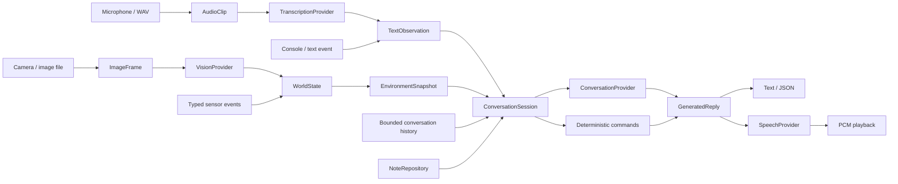

# Architecture

The current package implements an assistant session with text/audio conversation,
optional background vision, scalar sensor context, explicit memory, deterministic
commands, and optional spoken output. The original 2024 prototype has a documented
[retirement audit](legacy-retirement.md) and [history](history.md).

## Responsibilities and dependencies

| Package | Owns | Internal dependencies |
| --- | --- | --- |
| `application/` | Typed values/protocols, state, policies, conversation and lifecycle | Other application modules |
| `inputs/` | Console, files, cameras, microphone capture, endpointing, event parsing | Application values/interfaces |
| `outputs/` | PCM playback, WAV artifacts, simulated output | Application values/interfaces |
| `providers/` | OpenAI services and SQLite persistence | Application values/interfaces |
| `cli/` | Arguments, configuration, construction, task/resource ownership | All four packages |

Application code never imports concrete inputs, outputs, providers, SDKs, hardware
libraries or historical code. Inputs and outputs receive capabilities through
protocols. Providers do not drive devices or choose application behavior. Imports
must not load models, initialize clients, open devices, create threads or make
requests. Runtime resources belong to explicit context managers/startup wiring.

This remains one package, not a service mesh or plugin framework. Python with uv
is the current application environment. C++ is reserved for justified firmware or
native requirements; there is no empty C++ tree. Hosted inference is allowed;
local providers may implement the same relevant contracts later.

## Main data flow

`ImageFrame` acquisition is separate from interpretation. `SceneDescription`
becomes `VisualObservation` without replacing acquisition time. Audio capture
produces `AudioClip`; recognition produces `TextObservation` retaining source/time.
`SpeechProvider` generates audio; output code owns playback and device selection.
SDK objects stay inside providers.

## Read the implementation by responsibility

| Module | Purpose |
| --- | --- |
| `application/models.py`, `audio.py` | Immutable observations, timing/provenance, bounded image/audio values |
| `application/interfaces.py` | Acquisition, vision, transcription, speech and response contracts |
| `application/world_state.py` | Latest acquired visual scene and bounded scalar channels; frozen evidence snapshots |
| `application/perception.py`, `observation_loop.py` | Interpret frames, preserve timestamps, pace serial vision, select optional prior context |
| `application/runner.py` | Reusable typed input/result handling, initial vision readiness and task supervision |
| `application/conversation.py` | Serialize turns; combine sensory snapshot, notes and history; dispatch explicit commands |
| `application/memory.py` | Notes, embedding contract/cosine retrieval and bounded complete exchanges |
| `application/actions.py` | Numeric AST interpreter with explicit operators/functions/bounds |
| `application/behavior.py`, `runtime.py` | Deterministic touch-to-visual-context behavior and simulated event runtime |
| `inputs/image.py`, `webcam.py` | Shared image normalization; one-shot and continuous camera acquisition |
| `inputs/audio.py`, `microphone.py`, `vad.py` | WAV loading, bounded capture, energy endpointing |
| `inputs/console.py`, `events.py` | Cancellable Linux stdin and strict versioned device records |
| `outputs/audio.py`, `simulated.py` | Owned audio playback/artifacts and recorded simulation responses |
| `providers/openai.py`, `openai_services.py` | Vision, conversation, ASR, synthesis, optional embeddings; deadlines/errors/parsing |
| `providers/memory.py` | Owned SQLite connection, schema/index, bounded persistence/retrieval |
| `cli/__init__.py`, `configure.py` | Launcher, argument definitions and validation |
| `cli/assistant.py`, `audio.py`, `vision.py`, `memory.py` | Startup composition for each command family |

## State and timing

`WorldState` keeps one newest visual scene and at most 32 scalar channels keyed by
source/kind. Older/equal acquisitions cannot overwrite the retained value. It is
not object tracking, a map, identity recognition, or a complete world model.
Snapshots annotate missing/current/stale evidence at an explicit `as_of` time;
the default five-second threshold is policy, not an evaluated hardware requirement.

Acquisition, receipt, request and response times are distinct. Inference cannot
make an old image fresh. File timestamps default to pipeline acquisition, not a
historical recording date. Host camera read-start and audio callback estimates
are not sensor exposure clocks. Future evidence is rejected; cross-device clock
synchronization has not been implemented.

Conversation snapshots are frozen before retrieval/generation. They include
perception delay up to that moment; replies may take additional time and do not
recompute their wording at playback. JSON retains both snapshot and response time.
The deterministic touch behavior checks age at response generation. See
[assistant execution](assistant.md) and [vision timing](vision.md).

History stores at most 12 complete exchanges and 24,000 characters; explicit notes
are capped at 1,000, with at most three retrieved per chat turn. Notes persist
only with a selected SQLite path. Keyword retrieval is local; optional semantic
retrieval compares validated vectors from the same model/dimensions. Neither
relevance nor generated descriptions provide calibrated confidence. See [memory](memory.md).

## Concurrency, queues and cleanup

`application/runner.py:AssistantRunner` owns a foreground input/result loop plus
optional independent visual perception in an `asyncio.TaskGroup`. The CLI creates
and opens providers/devices, adapts input and formats/plays results; other hosts
can supply those same capabilities directly. The first turn waits for an initial visual result. Vision
and conversation can make separate requests concurrently; each capability's
request sequence is serial. A failing task cancels its sibling. On input EOF,
finite completion, failure or cancellation, an exit stack closes resources in
reverse acquisition order. Library hosts own their supplied resource contexts;
the runner owns its task group and closes an input iterator that offers `aclose`.
Single errors propagate directly; multiple task failures remain an ExceptionGroup.
See [embedding](embedding.md) for the runnable example and ownership contract.
No retries or model fallback hide failures.

`WebcamStream` owns open/read/release on one dedicated camera worker. Its producer
replaces one pending raw frame; only selected frames are normalized. The visual
loop waits an interval after handling a result; it is not fixed-rate scheduling.
Capture continues while inference/conversation runs. See [webcam](webcam.md).

Microphone capture has a 64-block callback queue; overflow fails explicitly. Voice
turns close input before transcription and playback. Playback is awaited with
bounded synthesis chunks; there is no speech queue or barge-in. Native operations
run off the event loop and finish before device release. A blocking driver call
can delay cancellation/shutdown; an API timeout does not bound device I/O.
See [audio](audio.md).

Stdin events are handled sequentially with bounded reader buffering/backpressure;
sensor records wait while a foreground turn/output is busy. There is no universal
live sensor multiplexer or priority scheduler. The separate simulated
`AssistantRuntime` consumes one event stream and awaits output. Its logical-clock
tests establish policy/lifecycle behavior, not physical timing.

## Provider and action boundaries

OpenAI defaults: `gpt-5.6-luna` for vision/conversation; `gpt-4o-mini-transcribe`
for ASR; `gpt-4o-mini-tts`/`coral` for speech; optional `text-embedding-3-small`
for semantic memory. Model names are configurable and must support the chosen
settings. Generative requests use `store=False`, no reasoning and bounded output;
vision inspection defaults to 20 s and assistant services to 30 s per request.
SDK retries are disabled. Credentials come from environment variables/ignored `.env`.
Current service contracts follow official documentation linked from execution guides.
`cli/environment.py` scopes automatic dotenv loading to the CLI invocation before
model defaults are parsed; shell variables win. `cli/parser.py` provides consistent
help/global options. See [CLI usage](cli.md) for the `prag` alias and device defaults.

Explicit `/commands` implement known rules/calculations and note operations.
Conversation has no tool/actuator access; generated text is never executed.
Untrusted context/notes are labeled as data. Decision models can be added for a
specific bounded judgment with evaluation; neither Jev nor OpenAI Decisions is
integrated. There is no justification for substituting inference for a numeric
calculation or a device limit.

## Physical integration and evidence limits

[Versioned sensor events](device-protocol.md) are a tested software interface.
No transport, controller, circuit, actuator protocol or robot form factor has
been chosen. A Linux Raspberry Pi remains a candidate, not a tested deployment.
Deadline-sensitive control and physical interlocks must remain local to the
controller; consult component documentation before implementing electrical I/O.
See [deployment](deployment.md).

Automated tests cover behavior, bounded work, SDK payloads, persisted recall,
partial startup, failures and cancellation using fake devices/services. Manual
vision/webcam checks and a synthetic live audio/semantic-conversation check are
recorded in the [retirement audit](legacy-retirement.md). Sustained operation,
real microphone/speaker tests, representative model evaluation, resource/timing
measurements and ARM deployment remain outstanding. None is implied by package
checks or removing obsolete code.

## Next milestones

See [the implementation roadmap](roadmap.md) for bounded request interpretation,
direct inspection judgments, companion context and evaluation. The reusable runner
is implemented; decision providers and typed robot behavior requests remain planned.
